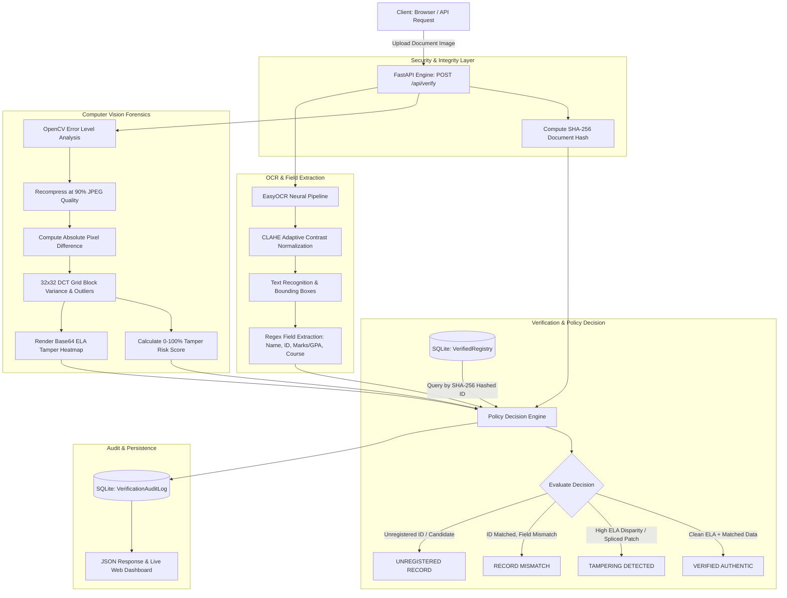

# DocuVerify AI: Automated Document Verification & Image Tampering Detection Engine

[](https://python.org)
[](https://fastapi.tiangolo.com)
[](https://opencv.org)
[](https://github.com/JaidedAI/EasyOCR)
[](https://tailwindcss.com)
[](LICENSE)

**DocuVerify AI** is a full-stack, production-grade automated document verification and image tampering detection engine. It combines computer vision forensics (**OpenCV Error Level Analysis**), optical character recognition (**EasyOCR**), and cryptographic security (**SHA-256 identity hashing & document integrity**) with an interactive modern web dashboard.
## Visual Verification Demo

| Authentic Document (Verified) | Tampered Document (Detected) |
| :--- | :--- |
|  |  |

---

## 🏛️ System Architecture



---

## ⚡ Key Features

1. **Error Level Analysis (ELA) Forensics**:
   - Re-compresses uploaded images in-memory at a controlled 90% JPEG quality.
   - Computes pixel-level difference matrices (`cv2.absdiff`) between original and recompressed frames.
   - Evaluates 32x32 DCT grid blocks using interquartile range (`IQR`) statistics to identify localized compression anomalies (indicative of digital splicing, pasted numbers, or forged stamps).
   - Generates a calibrated **0–100% Tamper Risk Score** (`LOW`, `MODERATE`, `HIGH`, `CRITICAL`) and outputs an interactive Base64 ELA Heatmap.

2. **EasyOCR Extraction Pipeline**:
   - Lazy-loaded singleton EasyOCR reader running in CPU mode for broad compatibility.
   - CLAHE (Contrast Limited Adaptive Histogram Equalization) preprocessing for crisp character edge separation.
   - Robust regular expression extractors parsing **Student ID** (`STU-\d{4,6}`), **Student Name**, **Marks / GPA** (`\d\.\d{1,2} GPA`, `\d+%`, `Grade A+`), and **Course / Degree**.

3. **Cryptographic Identity Protection & Data Integrity**:
   - Sensitive student identifiers are indexed and queried via **SHA-256 cryptographic hashes** in the SQLite database, ensuring student PII is never stored in plaintext keys.
   - Every uploaded document is fingerprinted with an immutable SHA-256 document hash recorded in the audit trail.

4. **Interactive Single-Page Dashboard (Phase 2)**:
   - Built with Tailwind CSS and Lucide Icons (zero npm build overhead).
   - Drag-and-drop document ingestion zone with live image preview and file metadata.
   - One-click "Quick Test Samples" for testing authentic, tampered, and unregistered credentials instantly.
   - Side-by-side forensic visualizer: Original Document alongside the ELA Tamper Heatmap with zoom lightbox.
   - Animated Tamper Risk Gauge with live percentage meters.
   - Real-time Verification Audit Trail table with 1-click hash copy and refresh capabilities.

5. **Dark-Themed Swagger Documentation**:
   - Custom slate-themed Swagger UI at `/docs` matching the application's aesthetic.

---

## 🛠️ Technology Stack

| Component | Technology | Purpose |
|:---|:---|:---|
| **Backend API** | FastAPI, Uvicorn | High-performance asynchronous REST endpoints |
| **Computer Vision** | OpenCV (`cv2`), Pillow, NumPy | Image processing, Error Level Analysis (ELA), DCT block variance |
| **OCR Engine** | EasyOCR, PyTorch | Deep-learning text recognition & field parsing |
| **Database & ORM** | SQLite, SQLAlchemy 2.0 | Institutional mock registry and verification audit trail |
| **Frontend UI** | HTML5, Tailwind CSS, Lucide Icons | Responsive glassmorphic dashboard (zero npm dependencies) |
| **Security** | Python `hashlib` (SHA-256) | PII identifier hashing and immutable document fingerprinting |

---

## 📂 Directory Structure

```
c:/DOC_VERIFY/
├── backend/
│   ├── main.py              # FastAPI application, static mounting & dark Swagger UI
│   ├── forensics.py         # OpenCV Error Level Analysis & DCT block anomaly forensics
│   ├── ocr_engine.py        # EasyOCR integration with regex field extractors
│   ├── database.py          # SQLAlchemy models (VerifiedRegistry, VerificationAuditLog)
│   ├── mock_data.py         # 5 realistic student records with SHA-256 hashed keys
│   ├── requirements.txt     # Backend Python dependencies
│   └── docuverify.db        # SQLite database
├── frontend/
│   ├── index.html           # Single-page dashboard interface
│   ├── style.css            # Dark theme, glassmorphism, animations & glow effects
│   └── app.js               # Reactive frontend logic, ELA renderer & audit log updater
├── test_samples/
│   ├── generate_samples.py  # Synthetic academic certificate generator
│   ├── test_api.py          # Automated verification test suite
│   ├── sample_authentic_david.jpg
│   ├── sample_authentic_sarah.jpg
│   ├── sample_authentic_elena.jpg
│   ├── sample_tampered_sarah.jpg
│   └── sample_unknown_student.jpg
├── walkthrough.md           # Implementation report with browser test screenshots
└── README.md                # Project documentation
```

---

## 🚀 Quickstart & Local Setup Guide

### 1. Prerequisites
- Python 3.12+ installed
- Windows PowerShell, macOS Terminal, or Linux Bash

### 2. Clone / Open Project
```powershell
cd c:\DOC_VERIFY
```

### 3. Install Dependencies
```powershell
pip install -r backend/requirements.txt
```

### 4. Initialize Database & Seed Records
```powershell
python -m backend.mock_data
```

### 5. Generate Test Sample Certificates
```powershell
python test_samples/generate_samples.py
```

### 6. Launch the FastAPI Server
```powershell
uvicorn backend.main:app --host 127.0.0.1 --port 8000 --reload
```

---

## 🌐 Accessing the Application

- **Web Dashboard**: [http://127.0.0.1:8000/](http://127.0.0.1:8000/)
- **Interactive Swagger Docs (Dark Theme)**: [http://127.0.0.1:8000/docs](http://127.0.0.1:8000/docs)
- **ReDoc API Reference**: [http://127.0.0.1:8000/redoc](http://127.0.0.1:8000/redoc)

---

## 🧪 Running the Automated Verification Test Suite

In a separate terminal, execute:
```powershell
python test_samples/test_api.py
```

The test script automatically verifies:
1. **Database Registry**: Confirms 5 seeded student records with SHA-256 hashed identifiers.
2. **Authentic Verification (David Chen)**: Validates `sample_authentic_david.jpg` -> `VERIFIED AUTHENTIC` (Low ELA risk).
3. **Authentic Verification (Sarah Jenkins)**: Validates `sample_authentic_sarah.jpg` -> `VERIFIED AUTHENTIC`.
4. **Tampering Detection (Sarah Jenkins Spliced)**: Validates `sample_tampered_sarah.jpg` -> `TAMPERING DETECTED` (Risk score: 69.87%, 16 anomalous DCT blocks, GPA divergence flagged).
5. **Unregistered Verification (Jonathan Doe)**: Validates `sample_unknown_student.jpg` -> `UNREGISTERED RECORD`.
6. **Audit Trail Persistence**: Verifies that all transactions are recorded in the SQLite audit log table.

---

## 📡 API Endpoints Reference

### `POST /api/verify`
Upload an image document to perform complete forensic and registry verification.

- **Content-Type**: `multipart/form-data`
- **Body**: `file`: Binary image file (JPEG, PNG, WebP)

**Sample cURL Request:**
```bash
curl -X POST "http://127.0.0.1:8000/api/verify" -F "file=@test_samples/sample_authentic_david.jpg"
```

**Sample Response:**
```json
{
  "status": "success",
  "verification_result": {
    "verdict": "VERIFIED",
    "is_authentic": true,
    "summary": "Document successfully verified authentic. Credentials match official record for David Chen (STU-77210) with low forensic tamper risk (10.33%)."
  },
  "forensic_analysis": {
    "tamper_risk_score": 10.33,
    "tamper_level": "LOW",
    "is_tampered": false,
    "mean_error": 0.58,
    "max_error": 38.0,
    "std_error": 1.68,
    "anomaly_ratio": 0.0,
    "anomalous_blocks": 0,
    "analysis_summary": "Uniform compression characteristics detected across all content blocks...",
    "ela_image_base64": "data:image/png;base64,..."
  },
  "extracted_data": {
    "detected_id": "STU-77210",
    "detected_name": "David Chen",
    "detected_marks": "91.5%",
    "detected_course": "B.Tech Electrical Engineering",
    "ocr_confidence": 0.94
  },
  "registry_comparison": {
    "matched": true,
    "official_record": {
      "student_name": "David Chen",
      "student_id": "STU-77210",
      "student_id_hash": "b82ef9155e266e1fc32...",
      "course": "B.Tech Electrical Engineering",
      "institution": "Apex National Institute of Technology",
      "marks_or_grade": "91.5%",
      "issue_year": 2023
    },
    "discrepancies": []
  },
  "audit_meta": {
    "audit_id": 1,
    "document_hash": "e3b0c44298fc1c149afbf4c8996fb92427ae41e4649b934ca495991b7852b855",
    "timestamp": "2026-09-13T14:20:00.000Z"
  }
}
```

### `GET /api/records`
Returns all mock verified registry records with SHA-256 hashed identifiers.

### `GET /api/audit-logs`
Retrieves historical verification records persisted in SQLite (`docuverify.db`).

### `GET /api/health`
Health check and system capabilities summary.

---

## 👥 Seeded Registry Records

| Student Name | Student ID | SHA-256 Hash Prefix | Degree / Course | Marks / GPA | Year |
|:---|:---|:---|:---|:---|:---|
| **Sarah Jenkins** | `STU-98421` | `211c4dcdc6d8...` | B.Sc. Computer Science | 3.92 GPA | 2024 |
| **David Chen** | `STU-77210` | `b82ef9155e26...` | B.Tech Electrical Engineering | 91.5% | 2023 |
| **Priya Sharma** | `STU-44109` | `f4cc51d8cb20...` | B.Sc. Data Science | 3.85 GPA | 2024 |
| **Marcus Vance** | `STU-11934` | `f683d3125909...` | B.A. Economics & Finance | Grade A+ | 2022 |
| **Elena Rostova** | `STU-65872` | `6a0374b40148...` | M.Sc. Cyber Security | 3.78 GPA | 2025 |

---

## 📄 License
This project is open-source and licensed under the MIT License.
